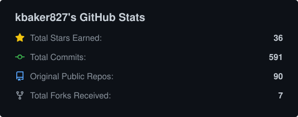
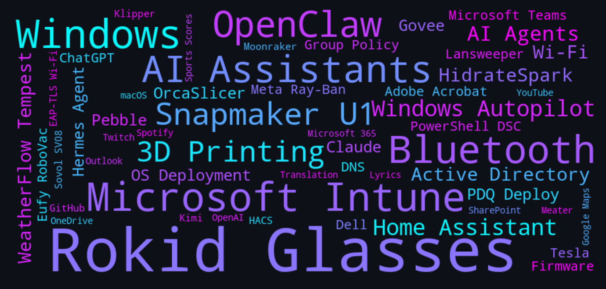
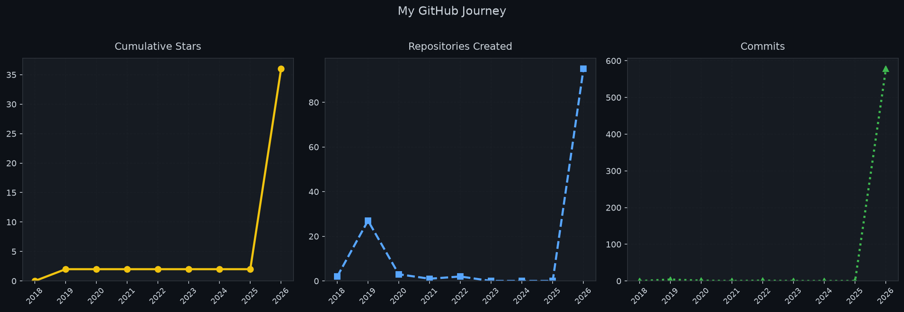
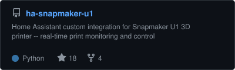
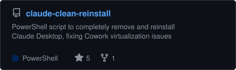
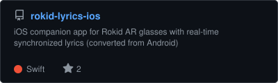
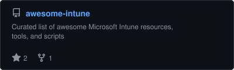
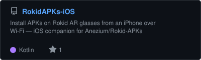
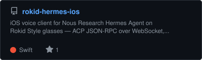

  

  <h1>Hey, I'm kbaker827 👋</h1>

  

    <strong>IT Systems Admin · Endpoint &amp; Intune Wrangler · Smart-Glasses Hacker · 3D-Printing &amp; Home-Automation Tinkerer</strong> 
    Based in Jacksonville, NC 🇺🇸
  

  &nbsp;
  

---

## About Me

By day I keep Windows fleets healthy — **Microsoft Intune**, **Autopilot**, **PDQ Deploy**, **Active Directory** and a lot of **PowerShell**. Most of the tools in my repos started as "there has to be a faster way to do this" moments at work.

By night I build things that probably didn't need building but are a lot more fun now that they exist:

- 🕶️ **Smart-glasses apps** — HUDs and companions for **Rokid** and **Meta Ray-Ban Display** glasses (Home Assistant, Tesla, Spotify, Teams, Claude, ChatGPT, water-intake tracking and more)
- 🖨️ **3D printing** — Home Assistant integrations, firmware tools and slicer profiles for the **Snapmaker U1** and **Sovol SV08**
- 🏠 **Home Assistant** — custom integrations and dashboards for printers, weather stations and smart bottles
- 🤖 **AI agents & skills** — OpenClaw skills, Claude / Hermes voice clients and assorted automation helpers
- 🛠️ **Sysadmin utilities** — GUI and CLI tools for Intune logs, stale profiles, ADMX templates, Dell warranties and more

---

## 📊 GitHub Stats

  
  &nbsp;
  

---

## 🛠️ Technologies & Platforms

> A word cloud of the apps, platforms and devices my repositories are built around — *not* the programming languages, but what they actually *do*.

  

---

## 📈 My GitHub Journey

> Yearly totals for stars earned, new repositories created and commits pushed — refreshed weekly by a GitHub Actions workflow.

  

---

## ⭐ Most Popular Repositories

<!-- PINNED:START -->

  
  
  
  
  
  

<!-- PINNED:END -->

---

## 🏠 Home Assistant Projects

> Custom integrations and dashboards I've built for Home Assistant — listed with release info and star counts.

  

---

  
    Profile assets (stats, word cloud, trend chart, repo cards &amp; HA page) are auto-refreshed weekly via
    <a href=".github/workflows/update-profile.yml">GitHub Actions</a>.
  

